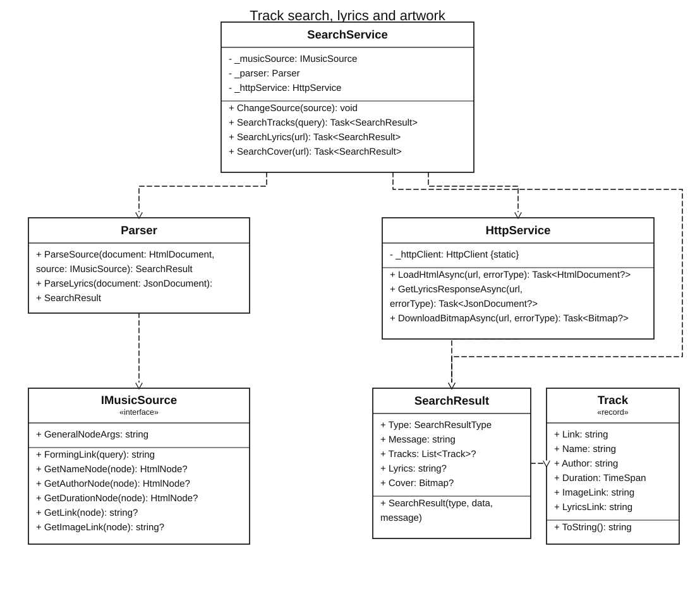
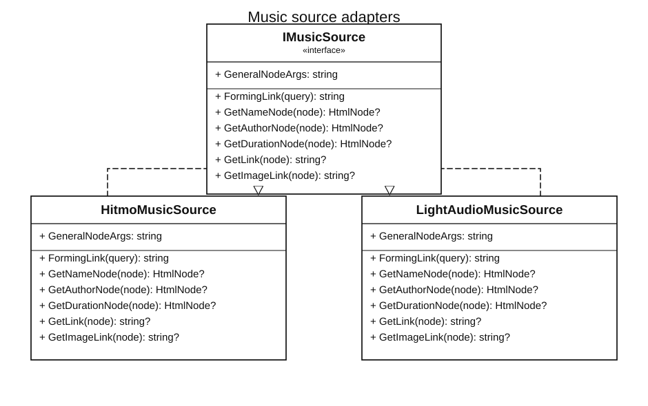
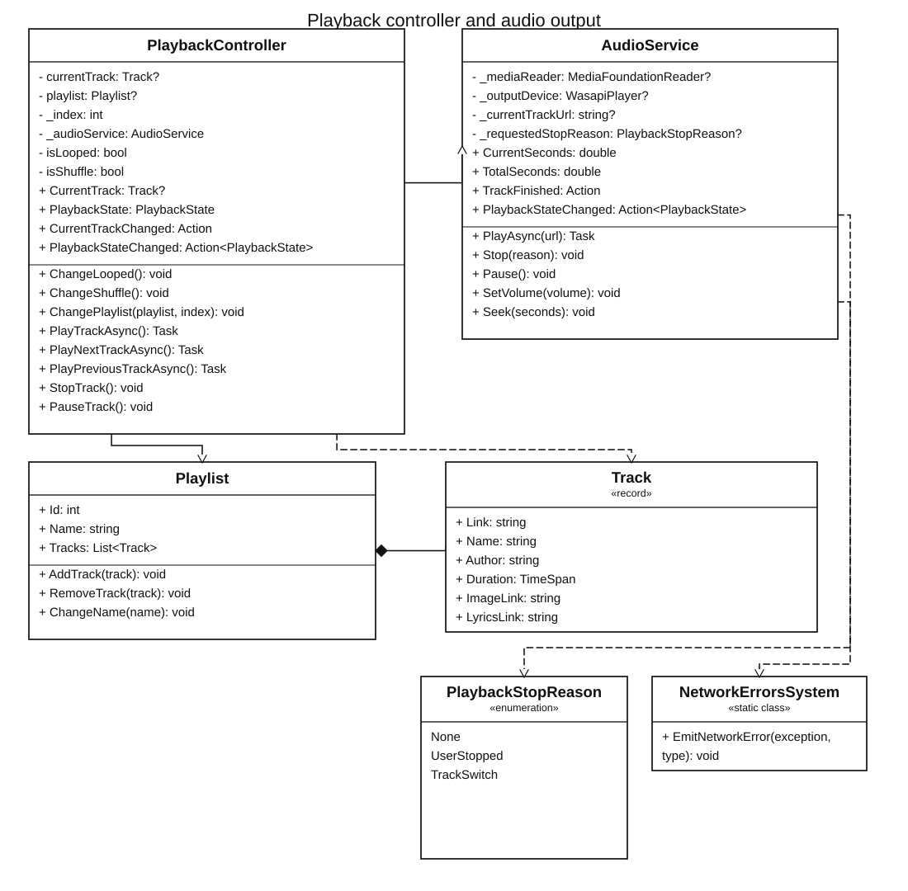
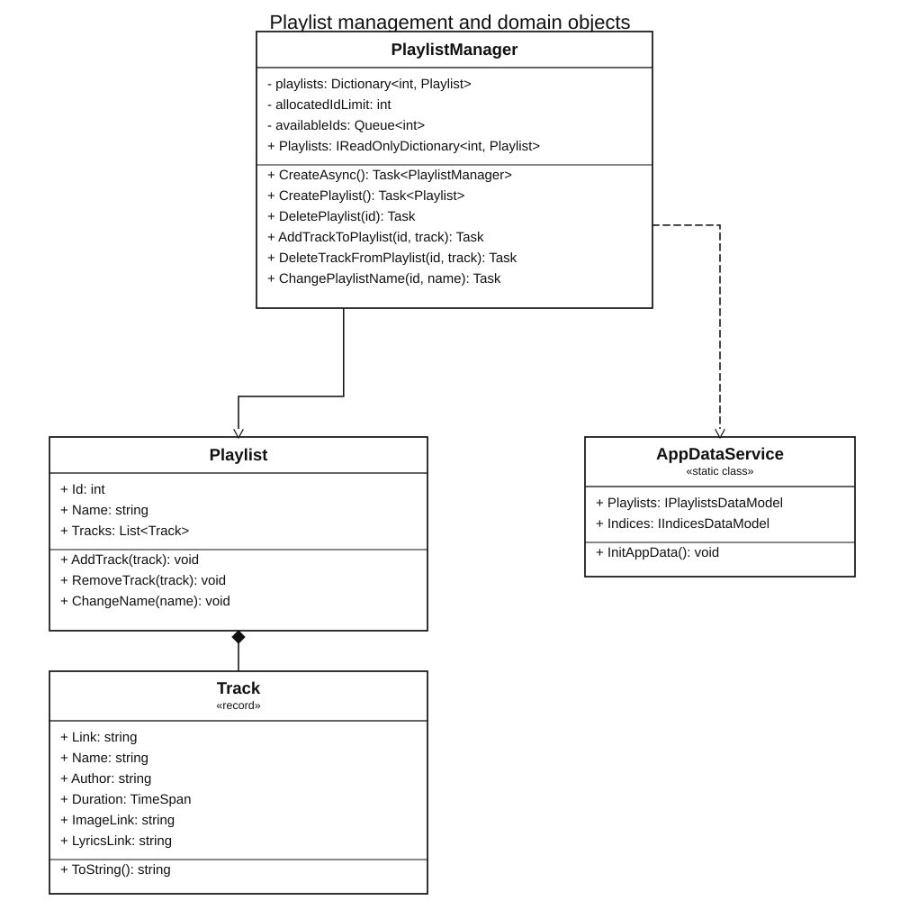
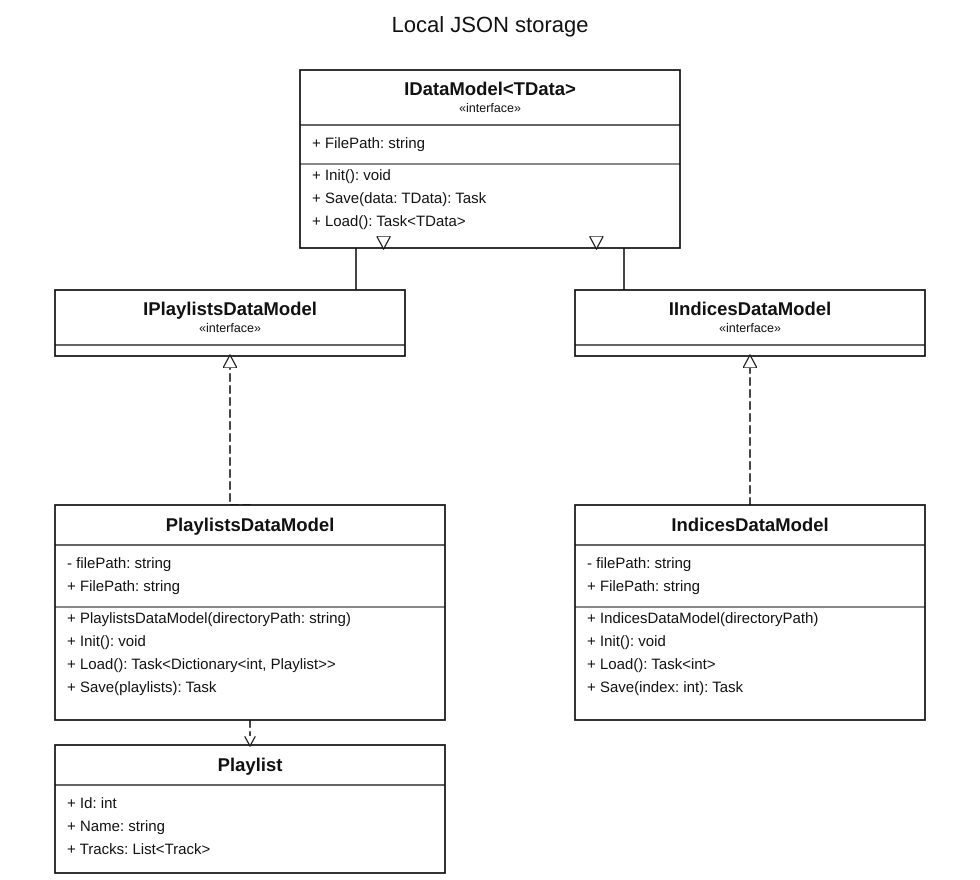
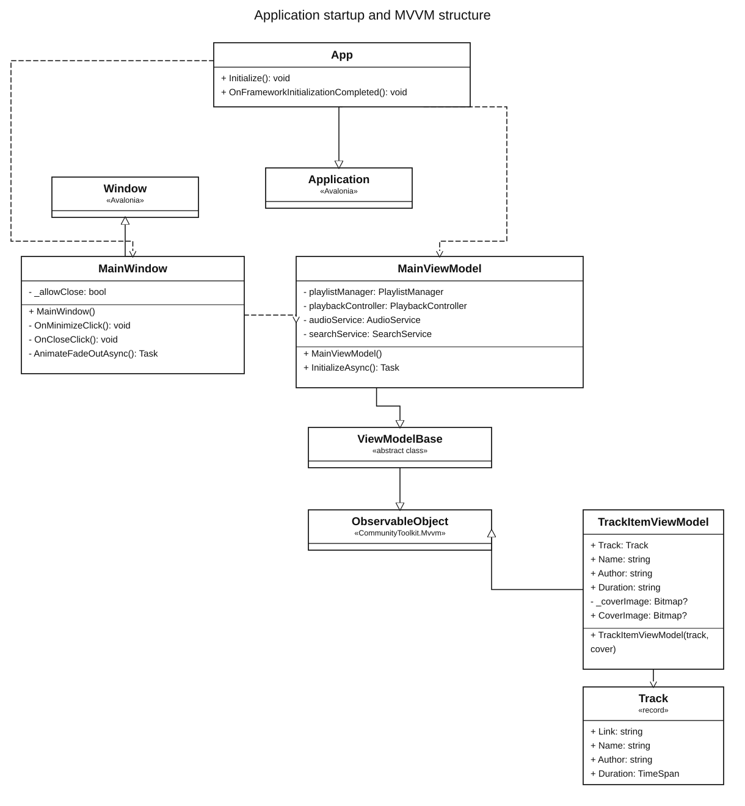

# MusicService

MusicService is a Windows desktop music player built with **C#**, **.NET 10** and **Avalonia UI**. It searches for tracks on external music websites, plays audio from the links returned by those sources, and keeps playlists between application launches.

The application stores track information and source URLs. It does not build or maintain a local library of downloaded audio files.

> **Project status:** the search, playback, playlist and storage services are in place. The Avalonia layout has been started, and the ViewModels are currently being connected to its bindings and commands.

[](LICENSE)

## What the application does

- Searches for tracks through configurable music-source adapters.
- Plays audio from the URLs returned by those sources.
- Keeps playlists and track metadata in local JSON files.
- Loads cover images from the image URLs found in search results.
- Looks up lyrics through the LRCLIB API.
- Provides playback logic for previous/next, shuffle and repeat-one.

Track availability depends on the external services. MusicService does not host the audio or grant rights to use content provided by those services.

## How the application works

### 1. Track search

The search logic is split between `SearchService`, `HttpService`, `Parser` and an `IMusicSource` implementation.

1. `SearchService` takes the search text and asks the selected `IMusicSource` to form the website's search URL.
2. `HttpService` downloads the page and loads its HTML into an `HtmlDocument`.
3. `Parser` uses the selected source adapter to locate the track nodes and read each track's title, artist, duration, audio URL and cover URL.
4. For each valid result, the parser creates a `Track`. The service returns the tracks inside a `SearchResult`.

The source-specific HTML selectors are kept out of `SearchService`. This means that another website can be added by implementing `IMusicSource`, without rewriting the search and parsing flow.



[PlantUML source](docs/diagrams/search-architecture.puml)

#### Music-source adapters

Each adapter knows the page structure of one website. `HitmoMusicSource` and `LightAudioMusicSource` both implement `IMusicSource`; they provide the search URL and the selectors used to extract the track information.



[PlantUML source](docs/diagrams/source-adapters.puml)

These integrations read third-party website HTML rather than official APIs. A markup change on a source website may require updating its adapter.

### 2. Lyrics and cover images

Lyrics and artwork use separate requests; neither is treated as part of the audio stream.

For lyrics, `Parser` creates an LRCLIB lookup URL from the artist and track title and stores it in `Track.LyricsLink`. When lyrics are requested, `SearchService.SearchLyrics` asks `HttpService` for the JSON response. `Parser.ParseLyrics` reads `plainLyrics` first and falls back to `syncedLyrics` when plain text is not available.

For artwork, the selected music-source adapter extracts an image URL. `SearchService.SearchCover` passes it to `HttpService.DownloadBitmapAsync`, which returns an Avalonia `Bitmap` for presentation in the interface.

The search diagram above shows the classes used for both operations: `SearchService`, `HttpService`, `Parser` and `SearchResult`.

### 3. Audio playback

`PlaybackController` manages the current playlist, current track and track index. It handles previous/next navigation, shuffle and repeat-one. When a track finishes naturally, the controller selects what should play next according to the active playback mode.

`AudioService` is responsible for audio output. It uses NAudio's `MediaFoundationReader` to read from the track URL and `WasapiPlayer` to play the stream. It also handles pause, stop, seeking, volume, playback-state notifications and the natural end of a track.



[PlantUML source](docs/diagrams/playback-architecture.puml)

The current audio implementation uses Windows-specific components, so this version of the application targets Windows.

### 4. Playlists

`PlaylistManager` owns the collection of playlists and provides operations for creating and deleting playlists, renaming them, and adding or removing tracks. Playlist IDs are allocated from a reusable queue; when the queue is empty, the manager expands the ID pool and updates its saved limit.

A `Playlist` contains a collection of `Track` objects. A `Track` stores metadata and links to the audio, artwork and lyrics sources, not an audio file.



[PlantUML source](docs/diagrams/playlist-management.puml)

### 5. Local data and persistence

Application data is stored under the current user's local application data directory:

```text
%LOCALAPPDATA%\MusicService\
├── playlists.json
└── indices.json
```

- `playlists.json` stores the playlists and their track metadata.
- `indices.json` stores the upper limit of the playlist IDs allocated so far.

`AppDataService` creates the application data directory and initializes both data models. The models share the `IDataModel<TData>` contract; `IPlaylistsDataModel` and `IIndicesDataModel` specialize it for their respective data types. `PlaylistsDataModel` and `IndicesDataModel` handle JSON serialization and file access.

Audio files are not copied into this directory.



[PlantUML source](docs/diagrams/local-storage.puml)

### 6. Desktop interface and MVVM

The desktop interface follows the **Model–View–ViewModel (MVVM)** approach. `App` creates `MainWindow` and assigns a `MainViewModel` as its `DataContext`. The XAML view defines the layout and binds its controls to ViewModel properties and commands.

`ViewModelBase` inherits from `ObservableObject` from CommunityToolkit.Mvvm. `TrackItemViewModel` wraps a `Track` and exposes the title, artist, duration and cover image for display. `MainViewModel` owns the application services used by the screen: `PlaylistManager`, `PlaybackController`, `AudioService` and `SearchService`.

The ViewModel integration is still in progress. In the current source, `MainViewModel` has its service fields and an `InitializeAsync` method, but it does not yet expose all properties and commands referenced by `MainWindow.axaml`. The startup code also needs to call `InitializeAsync` after creating the ViewModel. The window's code-behind currently handles window-level actions such as minimize and close animations.



[PlantUML source](docs/diagrams/mvvm-architecture.puml)

## Architecture at a glance

| Area | Responsibility |
| --- | --- |
| `Domain` | `Track` and `Playlist` entities. |
| `Application/PlaybackController` | Current track, playback state, shuffle, repeat and track navigation. |
| `Application/PlaylistManager` | Playlist operations and persistence coordination. |
| `Application/SearchService` | Search requests, parsing and search results. |
| `Audio` | NAudio playback implementation. |
| `Sources` | Website-specific implementations of `IMusicSource`. |
| `Infrastructure` | HTTP requests and network error events. |
| `Infrastructure/Storage` | Application data initialization and JSON data models. |
| `ViewModels` | Presentation state exposed to Avalonia. |
| `Views` | Avalonia XAML and window code-behind. |

The diagrams use standard UML class notation. Solid lines with open arrowheads represent navigable associations, dashed arrows represent dependencies, hollow triangles represent inheritance or interface realization, and the filled diamond represents composition. The SVG diagrams are embedded directly in this README. The matching `.puml` files are kept beside them in `docs/diagrams/` as editable PlantUML sources.

## Technology stack

| Technology | Role in the project |
| --- | --- |
| **C# / .NET 10** | Main application language and runtime. |
| **Avalonia UI** | Desktop interface and XAML views. |
| **MVVM** | Separates the views from presentation state and application logic. |
| **CommunityToolkit.Mvvm** | Observable ViewModel base classes and MVVM helpers. |
| **NAudio 3.1.0** | Audio reading and playback through Media Foundation and WASAPI. |
| **HtmlAgilityPack** | Parsing HTML returned by music websites. |
| **HttpClient** | HTTP requests for search pages, lyrics and artwork. |
| **System.Text.Json** | Local JSON persistence and LRCLIB response parsing. |
| **Python** | Auxiliary scripts and development tools; Python is not part of the application's runtime. |

## External sources

| Source | Use in MusicService |
| --- | --- |
| [Hitmo](https://rus.hitmos.fm/) | Track search and track metadata/links. |
| [LightAudio](https://web.ligaudio.ru/) | Alternative track search and track metadata/links. |
| [LRCLIB](https://lrclib.net/) | Lyrics lookup API. |

These services are independent of MusicService. Their availability, catalogues, response formats, website markup, terms and access restrictions may change.

## Project layout

```text
src/
├── Audio/
├── Domain/
├── Application/
│   ├── PlaybackController/
│   ├── PlaylistManager/
│   └── SearchService/
├── Infrastructure/
│   └── Storage/
│       └── DataModels/
├── Sources/
│   └── ImplementedSources/
├── ViewModels/
└── Views/

docs/
└── diagrams/
    ├── search-architecture.svg
    ├── search-architecture.puml
    ├── source-adapters.svg
    ├── source-adapters.puml
    ├── playback-architecture.svg
    ├── playback-architecture.puml
    ├── playlist-management.svg
    ├── playlist-management.puml
    ├── local-storage.svg
    ├── local-storage.puml
    ├── mvvm-architecture.svg
    └── mvvm-architecture.puml
```

## Build and run

The project targets .NET 10. On Windows, with the .NET 10 SDK installed, run these commands from the project directory:

```powershell
dotnet restore
dotnet build
dotnet run
```

## License

The project is intended to use the **GNU General Public License v3.0 only** (`GPL-3.0-only`). Before publishing or distributing the repository, make sure the `LICENSE` file contains the complete, unmodified GPL-3.0 text.
